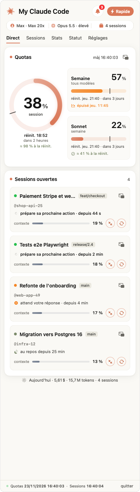
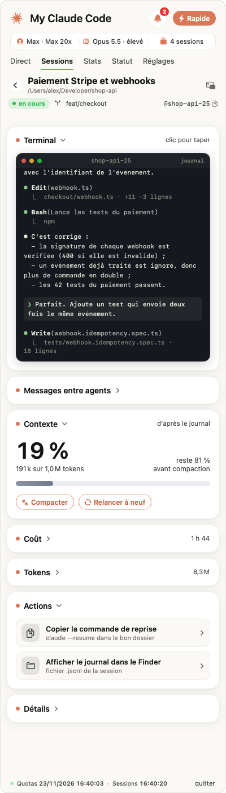
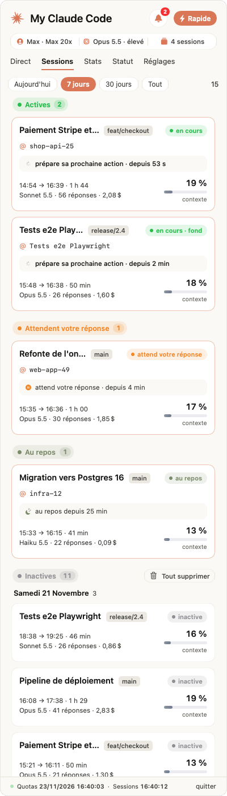
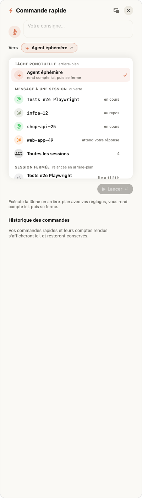
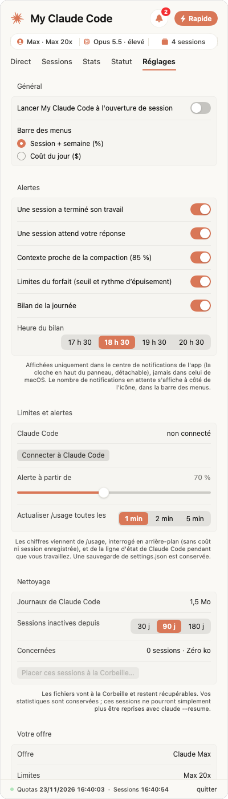

<div align="center">


# My Claude Code

**Everything Claude Code is doing, one click away in your menu bar.**

Quotas and when they will run out · every session, live · its real terminal, in colour · notifications that
never interrupt you · a quick command you can dictate — native, fast, and nearly free to run.


<br>

&nbsp;&nbsp;
&nbsp;&nbsp;


</div>

> The interface is in French. Everything stays on your Mac: the app reads your local `~/.claude` folder and
> sends nothing anywhere. *(Screenshots use made-up demo data — see [Screenshots](#screenshots).)*

---

## Contents

[Highlights](#highlights) · [Requirements](#requirements) · [Install](#install) · [First steps](#first-steps) ·
[Tour](#tour) · [Settings](#settings) · [Privacy & cost](#privacy--cost) · [FAQ](#faq) ·
[Build from source](#build-from-source) · [Screenshots](#screenshots) · [License](#license)

## Highlights

| | |
|---|---|
| 📊 **Quotas & forecast** | Session, weekly and per-model limits, refreshed on every Claude Code reply, with the moment each one will run out at your current pace. |
| 🟢 **Live sessions** | Every open session — interactive or background — with what it is doing *right now*, its context and one-click actions. |
| 🖥 **The real terminal** | Background sessions get a real terminal in the app (`claude attach`); interactive ones an exact, coloured mirror of their iTerm tab. Click to type, scroll with the trackpad. |
| 🔁 **Compact & relaunch** | *Compacter* keeps a synthesis note across `/compact`; *Relancer à neuf* hands a session over to a fresh one without losing anything. |
| 🔔 **Quiet notifications** | Finished, waiting for you, context nearly full, quota at risk — counted in the menu bar, listed in the app, never a macOS banner, never a window popping up. |
| ⚡ **Quick command** | Type or dictate: start a project in a new iTerm tab, message a session, or hand a task to an ephemeral agent. |
| 🪟 **Floating windows** | Quotas, notifications, any session or the quick command float above everything, even full-screen apps. |
| 🪶 **Nearly free** | ~0 % CPU and ~45 MB of memory while the panel is closed; the panel opens in about 20 ms. |

## Requirements

- An Apple Silicon Mac running **macOS 14 Sonoma or later**. No administrator rights needed.
- **[Claude Code](https://claude.com/claude-code)** installed, with `claude` on your `PATH`.
- **[iTerm2](https://iterm2.com)** *(recommended)* — for the mirror of interactive sessions, new projects and
  relaunches. Turn on **iTerm2 › Settings › General › Magic › Enable Python API** for colours in the mirror and
  for typing into a tab even while the hotkey window is hidden (no Python needed). Everything else works without
  iTerm2.

## Install

1. [Build it](#build-from-source) (one command), or open the `.dmg` you were given.
2. Put **My Claude Code** in your **personal** Applications folder (Finder › Go › Home › Applications).
3. A copy that is not notarized opens with **right-click › Open** the first time.

The icon appears in the menu bar. Click it; that is the only way the panel ever opens.

## First steps

1. **Connect the status line** — *Réglages › Connecter à Claude Code*. A small script is added to
   `~/.claude/settings.json` (backed up first) so figures update on every reply. Your own status line is never
   replaced without asking.
2. **Allow** the microphone (dictation) and the control of iTerm when macOS asks.
3. **Launch at login** — *Réglages › Général*.

## Tour

### Menu bar


Session and weekly usage at a glance (or today's cost), in red past your alert threshold. Waiting notifications
show as a **count** in a small clay badge — the panel itself never opens on its own.

### Direct — what matters, live


- **Quotas** — the session ring, weekly and per-model limits, their reset time and a forecast: *épuisé jeu.
  11:39* in orange when a quota will run out before it resets, otherwise *≈ 41 % à la réinit.*
- **Open sessions** — interactive and background (*fond*), most active first: what the agent is doing, for how
  long, its context, and two discreet actions on every card — **compact** and **relaunch fresh**.
- Click a card to open the session; the ⧉ icon detaches it into a floating window.

<br clear="right">

### Sessions



- Today, 7 days, 30 days or everything; open sessions by state, then the others by day.
- Each session shows its **real name** (the title Claude Code gave it) and its messaging name (`@shop-api-25`).
- **Swipe left** to stop or delete a session (its transcript goes to the Trash, recoverable), or right-click.
- **Tout supprimer** clears every inactive session of the period, after confirmation.

<br clear="right">

### A session


- **Terminal** — the session itself:
  - *background session*: a real terminal running `claude attach`, exactly Claude Code's interface;
  - *interactive session*: the exact screen of its iTerm tab, character for character, in your iTerm font and
    colours;
  - *closed session*: its history, rebuilt from the transcript (*journal*).

  **Click it to type** — text, Return, Esc, Tab, ⌃C, arrows. It only takes the keyboard after a click, so Esc
  still closes the panel otherwise. Scroll with the wheel or the trackpad.
- **Contexte** with **Compacter** and **Relancer à neuf** (see below), **Coût**, **Tokens**, **Détails**.
- **Messages entre agents** — what the session exchanged with your other sessions and the app.
- **Actions** — resume in iTerm, copy the resume command, reveal the transcript, delete.

<br clear="right">

#### Compacter & Relancer à neuf

- **Compacter** — the session writes a synthesis note (goal, progress, decisions, key files, next step) to
  `~/.claude/session-notes/`, then `/compact` runs and keeps it. Works for interactive and background sessions.
- **Relancer à neuf** — for a session that grew too long: it writes the same note, a **new session** starts in a
  new tab of your iTerm hotkey window, same folder and same model, with a prompt to read the note and carry on.
  Only once the new session is seen running is the old one stopped, its tab closed and its transcript moved to the
  Trash; then the app switches to the new one. Any failure stops before anything is closed. Asks for a
  confirmation first.

### Notifications


From the bell, grouped by day: a session **finished**, is **waiting for your answer**, its **context is nearly
full** (with *Compacter*), a quota **crossed your threshold** or **will run out early**, and an optional **daily
summary**. Click one to open its session. Nothing is ever posted to macOS Notification Center and the panel
never opens by itself: the menu bar count tells you.

<br clear="right">

### Quick command



Type or **dictate** an instruction, choose where it goes, press Return:

| Destination | What happens |
|---|---|
| **Agent éphémère** | A one-off Claude Code agent does the task in the background and reports back here. |
| **A session** (or all) | Typed straight into it — instant, no relay. Closed sessions are relaunched in the background with their history. |
| **Nouveau chantier** | A new tab in your iTerm hotkey window, Claude Code started in the chosen folder with your instruction. |

<br clear="right">

### Floating windows

&nbsp;&nbsp;


Quotas, notifications, any session and the quick command detach (⧉) into small windows that stay above
everything on every Space — handy during a video call. Drag them from anywhere, resize them from their edges;
they come back in place at the next launch.

### Stats & Statut

- **Stats** — API-equivalent costs, tokens, replies, models, projects, activity calendar, hours and weekdays.
  Cards can be reordered and hidden.
- **Statut** — Claude Code version and status, configuration and MCP servers.

## Settings



| Section | Options |
|---|---|
| **Général** | Launch at login; menu bar content. |
| **Alertes** | One switch per notification type; daily summary time. |
| **Limites et alertes** | Status line, alert threshold, `/usage` refresh (1, 2 or 5 min). |
| **Nettoyage** | Move sessions older than 30, 90 or 180 days to the Trash. |

<br clear="right">

## Privacy & cost

- The app reads `~/.claude` (transcripts, sessions, jobs, settings) and runs your local `claude` CLI; its own
  data lives in `~/Library/Application Support/My Claude Code`. No telemetry, no network calls of its own.
- Reading quotas (`/usage`), transcripts and terminals costs **no tokens**. Compacting, relaunching, ephemeral
  agents and messages go through Claude Code like anything you type.
- While the panel is closed the app stays nearly idle: no file is re-read and no process is started unless
  something changed.

## FAQ

**The mirror has no colours / says “journal”.** Enable iTerm's Python API (see [Requirements](#requirements)) and
allow the app to control iTerm (System Settings › Privacy & Security › Automation). *Journal* means the session
has no terminal any more (closed).

**How do I scroll a background session's terminal?** Like in iTerm: the wheel and the trackpad are passed to
Claude Code, which scrolls its own conversation.

**“Fenêtre à raccourci d'iTerm introuvable”.** New projects and relaunches open in iTerm's hotkey window: set one
up in iTerm › Settings › Keys › Hotkey and open it once.

**My microphone stopped working with the lid closed.** macOS turns the built-in microphone off in clamshell mode;
pick another input in System Settings › Sound.

## Build from source

Apple's developer tools (Xcode or `xcode-select --install`) with Swift 5.10 or later — nothing else. The terminal
emulator ([SwiftTerm](https://github.com/migueldeicaza/SwiftTerm) 1.8, MIT) is vendored and built by the script.

```sh
git clone https://github.com/fredericvilcot/my-claude-code.git
cd my-claude-code
./build.sh            # → build/My Claude Code.app
./build.sh --install  # builds, copies it to ~/Applications and launches it
```

If a code signing identity named *Local Menu Apps Signing* exists in your keychain, the script uses it so macOS
keeps its permissions across rebuilds; otherwise the app is signed ad hoc.

```
Sources/App/      entry point, menu bar panel, floating windows
Sources/Data/     transcripts, quotas & forecasts, sessions, iTerm (AppleScript + API), notifications
Sources/Views/    SwiftUI views
Vendor/SwiftTerm  terminal emulator (MIT)
docs/             screenshots and the demo data that produces them
```

## Screenshots

Every picture above comes from **made-up data**, never from a real account:

```sh
./docs/screenshots.sh
```

It builds a fake home (`docs/demo/make-demo.py`: projects, five weeks of history, open sessions, a background
job, quotas), runs a copy of the app on it in demo mode (`MCC_DEMO`, `CFFIXED_USER_HOME`, its own preferences —
it never calls `claude`), captures every screen into `docs/screenshots/`, then deletes it all.

## License

[PolyForm Noncommercial 1.0.0](LICENSE.md) © 2026 Frédéric Vilcot — free for any **noncommercial** use
(personal, research, education, hobby, charitable and public organizations). Commercial use requires a separate
license from the author.
