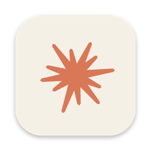
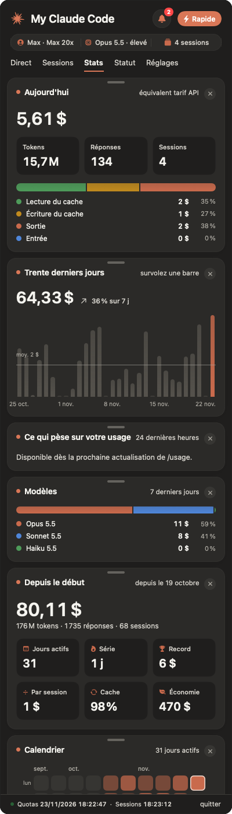
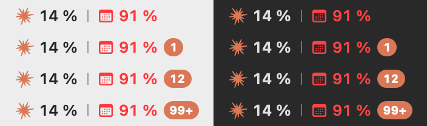
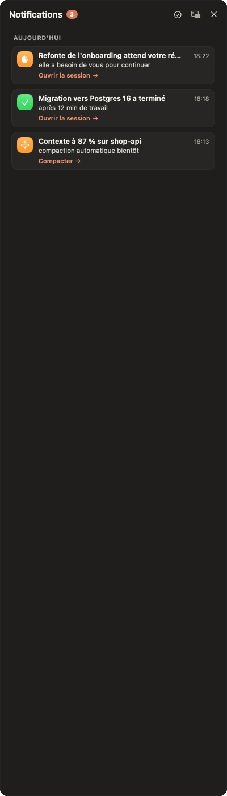
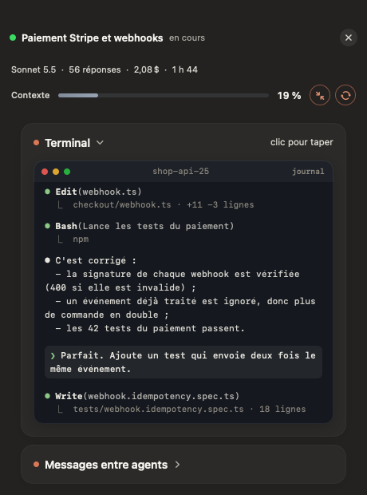
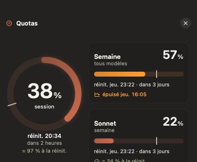

<div align="center">



# My Claude Code

### Everything Claude Code is doing, one click away in your menu bar.

Usage limits and when you will hit them · every session, live · its terminal, in colour · quiet notifications ·
a quick command you can type or dictate.

[](#requirements)
[](#requirements)
[](#build-from-source)
[](LICENSE.md)
[](https://github.com/fredericvilcot/my-claude-code/stargazers)
[](https://github.com/fredericvilcot/my-claude-code/commits/main)

<br>

&nbsp;&nbsp;&nbsp;
&nbsp;&nbsp;&nbsp;


</div>

<br>

> [!NOTE]
> My Claude Code is an independent, unofficial companion for [Claude Code](https://claude.com/claude-code).
> It runs entirely on your Mac and sends nothing anywhere. Its interface is in French.

## Table of contents

- [Features](#features)
- [What makes it different](#what-makes-it-different)
- [Requirements](#requirements)
- [Installation](#installation)
- [Getting started](#getting-started)
- [Tour](#tour)
- [Privacy](#privacy)
- [FAQ](#faq)
- [Architecture](#architecture)
- [Build from source](#build-from-source)
- [License](#license)

## Features

- **Usage limits & forecast** — session, weekly and per-model limits, updated on every reply, with the moment each
  one will run out at your current pace.
- **Every session, live** — what each open session is doing right now, for how long, and how full its context is.
- **Its terminal** — watch any session's terminal from the panel, in colour; click to type, scroll to read back.
- **Compact & start fresh** — keep a written summary across `/compact`, or hand a long session over to a new one
  without losing the thread.
- **Quiet notifications** — finished, waiting for you, context nearly full, limit at risk: a count in the menu bar,
  never a pop-up, never a window opening by itself.
- **Quick command** — type or dictate to start a project, message a session, or hand a one-off task to an agent.
- **Floating windows** — keep your limits or a session on screen, above everything, even full-screen apps.
- **Statistics** — costs, tokens, models, projects and an activity calendar.
- **Light** — about 45 MB of memory and ~0 % CPU while the panel is closed; the panel opens in a few milliseconds.

## What makes it different

Plenty of tools show **one piece** of the picture. My Claude Code is the only one we know of that brings it all
together, around the terminals you already use:

| | Usage trackers in the menu bar | Session managers | Claude Code's Agent View | **My Claude Code** |
|---|:---:|:---:|:---:|:---:|
| Usage limits **with a forecast** | some | — | — | ✅ |
| Every session live, interactive **and** background | some | ✅ | background | ✅ |
| **The real terminal** of each session, in colour, with keyboard | — | their own terminal | in the CLI | ✅ your iTerm tabs, as they are |
| **Start fresh** — hand a long session over to a new one, nothing lost | — | — | — | ✅ |
| Messages between agents, per session | — | — | — | ✅ |
| Quick command you can **dictate** | — | — | — | ✅ |
| Floating windows over full-screen apps | — | — | — | ✅ |
| Lives in the menu bar, ~0 % CPU when closed | ✅ | — | — | ✅ |

- **No new workflow.** Keep working in iTerm or in background sessions; the app watches and drives what is already
  there instead of replacing your terminal.
- **Nothing is lost.** *Compact* and *start fresh* write a synthesis note first, and an old session is closed only
  once its replacement is running.
- **Native and light.** Swift, SwiftUI and AppKit — no Electron, no web view, no server.

> If My Claude Code saves you time, a ⭐ on GitHub helps other Claude Code users find it.

## Requirements

| | |
|---|---|
| **Mac** | Apple Silicon (M1 or later), macOS 14 Sonoma or later |
| **Claude Code** | [Installed](https://claude.com/claude-code), with `claude` on your `PATH` |
| **Developer tools** | Xcode, or the Command Line Tools (`xcode-select --install`), Swift 5.10 or later |
| **iTerm2** *(recommended)* | For the live terminal of interactive sessions, new projects and *start fresh* |

No administrator rights are needed.

## Installation

**1. Get the code**

```sh
git clone https://github.com/fredericvilcot/my-claude-code.git
cd my-claude-code
```

**2. Build and install**

```sh
./build.sh --install
```

This builds the app, copies it to `~/Applications/My Claude Code.app` and opens it. The icon appears in your menu
bar.

**3. Update later**

```sh
git pull && ./build.sh --install
```

<details>
<summary>Uninstall</summary>

```sh
rm -rf ~/Applications/"My Claude Code.app"
rm -rf ~/Library/Application\ Support/"My Claude Code"
defaults delete app.myclaudecode.MyClaudeCode
```

If you connected the status line, remove it first from *Réglages › Déconnecter*.
</details>

## Getting started

1. **Open the panel** — click the icon in the menu bar. It only ever opens on a click.
2. **Connect to Claude Code** — *Réglages › Connecter à Claude Code*. Your limits then update on every reply.
   A backup of `~/.claude/settings.json` is kept, and an existing status line is never replaced without asking.
3. **Allow access** when macOS asks — the microphone for dictation, and the control of iTerm for terminals.
4. **Colours in the terminal** — in iTerm2, turn on *Settings › General › Magic › Enable Python API*.
5. **Start at login** — *Réglages › Lancer My Claude Code à l'ouverture de session*.

## Tour

### Menu bar



Session and weekly usage at a glance, in red near your limit. A small badge counts the notifications waiting for
you.

### Live


Your limits with their reset time and a forecast — *“runs out Thursday 11:39”* when you are going too fast.
Below, every open session: what it is doing, for how long, its context, and two discreet actions — **compact** and
**start fresh**.

<br clear="right">

### Sessions


All your sessions by day, each under its real name. Swipe left to stop or delete one — deleted sessions go to the
Trash and can be restored. Click a session to open it.

<br clear="right">

### A session


- **Terminal** — exactly what the session shows; click to type, scroll to read back.
- **Messages between agents** — what other sessions or the quick command sent to it, and its replies.
- **Compact** — the session writes a summary of its work, then compacts and keeps it.
- **Start fresh** — a new session picks up from that summary; the old one closes only once the new one runs.
- **Context, cost, tokens** and details.

<br clear="right">

### Notifications



A session finished, is waiting for your answer, or is about to compact; a limit crossed your threshold or will run
out early; an optional end-of-day summary. Click one to jump to its session.

<br clear="right">

### Quick command


Type or dictate, choose a destination, press <kbd>Return</kbd>:

- **One-off agent** — does the task in the background and reports back here.
- **A session**, or all of them — the message goes straight to it.
- **New project** — opens a new terminal tab and starts Claude Code there.

<br clear="right">

### Floating windows

&nbsp;&nbsp;


Detach your limits, notifications, a session or the quick command into small windows that stay on top — handy
during a call. Move them from anywhere, resize them from their edges.

## Privacy

- **Local only.** The app reads Claude Code's files in `~/.claude` and keeps its own data in
  `~/Library/Application Support/My Claude Code`. No account, no telemetry, no server.
- **No hidden cost.** Watching limits, sessions and terminals uses no tokens. Compacting, starting fresh, quick
  commands and messages go through Claude Code like anything you type yourself.
- **Safe actions.** Deleted sessions go to the Trash; a session is only closed once its replacement is running.

## FAQ

<details>
<summary><b>Is this an official Anthropic app?</b></summary>

No. It is an independent companion app for Claude Code.
</details>

<details>
<summary><b>Do I need iTerm2?</b></summary>

No. Limits, sessions, notifications and statistics work without it. The live terminal of interactive sessions,
new projects and *start fresh* use iTerm2.
</details>

<details>
<summary><b>The terminal has no colours.</b></summary>

Turn on iTerm2's Python API (*Settings › General › Magic*) and allow My Claude Code to control iTerm in
*System Settings › Privacy & Security › Automation*.
</details>

<details>
<summary><b>My limits don't update.</b></summary>

Connect the app to Claude Code in *Réglages*. Without it, limits refresh every minute.
</details>

<details>
<summary><b>Does it work with full-screen apps?</b></summary>

Yes. Over a full-screen app the panel opens as a menu, and floating windows stay visible.
</details>

## Architecture

A native Swift app (SwiftUI + AppKit) with a **hexagonal architecture** whose boundaries are checked by the compiler
on every build.

```
Sources/
├── Core/                 Foundation only
│   ├── Domain/           sessions, limits & forecasts, usage statistics, pricing
│   ├── Ports/            what the use cases need from the outside world
│   └── Application/      use cases: compact, start fresh
├── Adapters/
│   ├── ClaudeCode/       transcripts, sessions and jobs, claude CLI, status line
│   ├── ITerm/            iTerm2 (AppleScript and official API), terminal input
│   └── System/           Trash, alerts
├── App/                  composition root, app state, menu bar panel, windows
└── UI/                   SwiftUI views
Vendor/SwiftTerm/         terminal emulator (MIT)
```

- **Dependencies point inwards** — `build.sh` type-checks the domain alone, then the core without adapters or UI,
  and rejects any UI framework import in the core.
- **One composition root** — `App/Composition.swift` is the only place where adapters meet the core.
- **Responsive by design** — files are read in the background, terminals run on their own queues.
- **Reproducible screenshots** — `docs/screenshots.sh` regenerates every picture from made-up data.

## Build from source

```sh
./build.sh              # build/My Claude Code.app, architecture checks included
./build.sh --install    # build, install to ~/Applications and open
./docs/screenshots.sh   # regenerate the screenshots from demo data
```

If a code signing identity named *Local Menu Apps Signing* exists in your keychain, it is used so that macOS keeps
its permissions across rebuilds; otherwise the app is signed ad hoc.

## License

[PolyForm Noncommercial 1.0.0](LICENSE.md) © 2026 Frédéric Vilcot.
Free for any noncommercial use — personal, research, education, hobby, charitable and public organizations.
Commercial use requires a separate license.
